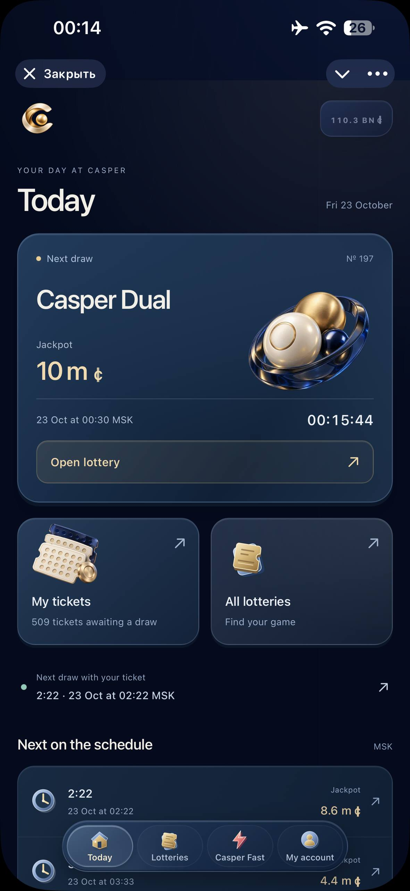
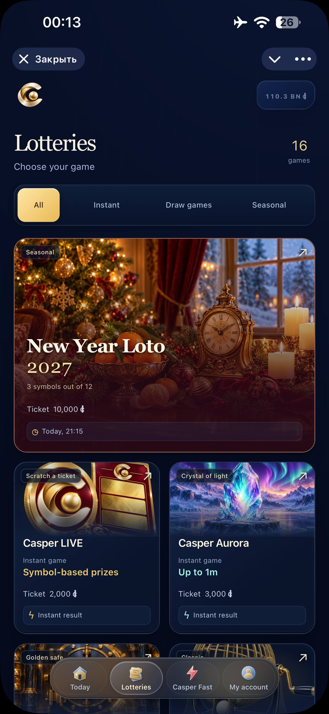
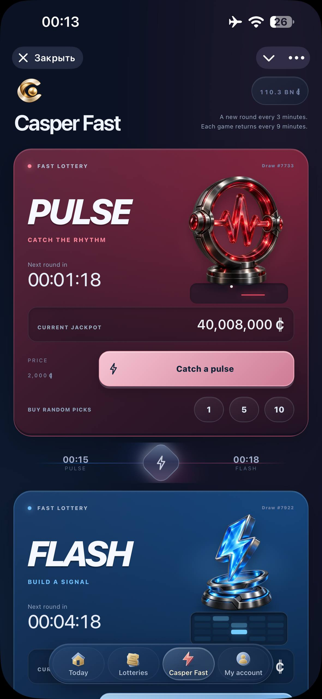
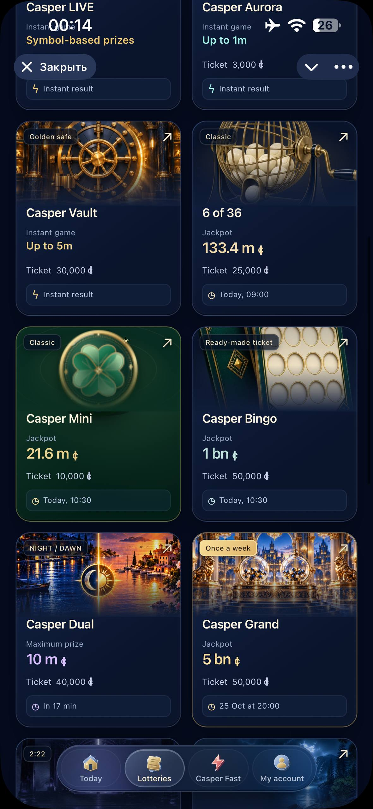
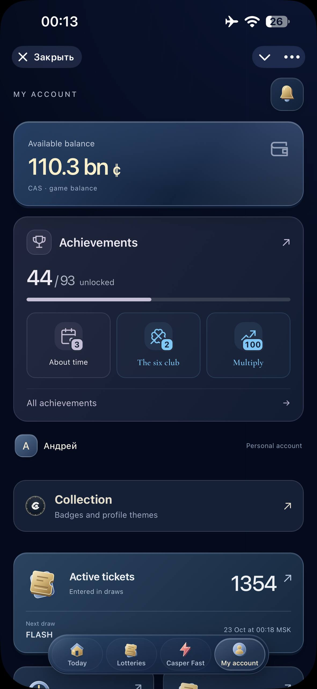

<p align="center"><a href="README.md">English</a> · <strong>Русский</strong></p>

<p align="center">
  <a href="https://t.me/Kasper_loto_bot?startapp">
    
  </a>
</p>

<h1 align="center">Удача ничего не стоит</h1>

<p align="center">
  Бесплатные лотереи в Telegram. Виртуальная валюта, настоящие эмоции.
  <br>
  Без доната, денежных ставок и вывода денег.
</p>

<p align="center">
  <a href="https://t.me/Kasper_loto_bot?startapp"><strong>Просто попробуй →</strong></a>
  &nbsp; · &nbsp;
  <a href="https://t.me/casper_loto">Новости проекта</a>
  &nbsp; · &nbsp;
  <a href="https://t.me/rabochyru">Написать мне</a>
</p>

<p align="center">
  Языки игры: <strong>Русский · English</strong><br>
  <a href="README.md">Read this page in English →</a>
</p>

---

[Об игре](#об-игре) · [Скриншоты](#скриншоты) · [Как начать](#как-начать) · [От автора](#от-автора) · [Планы](#планы) · [Разработчикам](#разработчикам)

## Об игре

**Casper Loto** — мой независимый проект с числовыми лотереями, быстрыми
тиражами, моментальными играми и сезонными событиями. Здесь можно выбрать
свою комбинацию, дождаться розыгрыша, открыть достижение и собрать коллекцию
значков и тем для профиля.

Всё работает на **CAS — виртуальной игровой валюте**. За неё берут билеты
и получают игровые призы. CAS нельзя купить за настоящие деньги, вывести
или обменять на деньги. Все суммы и джекпоты в интерфейсе — игровые.

**В Casper Loto нет и не будет покупок за реальные деньги.** Это принцип
проекта: ни доната, ни продажи CAS, билетов или платных преимуществ.

## Во что можно поиграть

| Хочется… | Что попробовать |
| --- | --- |
| Выбрать числа и дождаться тиража | «6 из 36», Casper Mini, Casper Grand и другие числовые лотереи |
| Взять готовую карточку | Casper Bingo |
| Сыграть в два этапа | Casper Dual с розыгрышами NIGHT и DAWN |
| Быстро узнать результат | Casper Fast: FLASH, CODE и PULSE |
| Раскрыть билет сразу | Моментальные Casper LIVE, Casper Aurora и Casper Vault |
| Особого настроения | Тематические игры, включая Halloween и «Новогоднее лото 2027» |
| Собирать свой прогресс | Достижения, награды, значки и темы профиля |

У каждой игры свои правила, оформление и призовые категории. В разделе
**Casper Fast** очередной раунд проходит каждые **3 минуты**, а каждая из
трёх игр возвращается каждые **9 минут**.

## Скриншоты

Эти скриншоты я сделал на своём iPhone, когда готовил README. Показываю игру
как есть, без макетов и ретуши. Здесь выбран английский интерфейс; все эти
разделы доступны и на русском. По нажатию снимок откроется целиком.

<p align="center">
  <a href="assets/readme/today-iphone.png"></a>
  &nbsp;
  <a href="assets/readme/lotteries-iphone.png"></a>
  &nbsp;
  <a href="assets/readme/fast-iphone.png"></a>
</p>

<p align="center"><em>«Сегодня» · Каталог лотерей · Casper Fast</em></p>

<details>
<summary><strong>Ещё два экрана: другие лотереи и личный кабинет</strong></summary>

<br>

<p align="center">
  <a href="assets/readme/lotteries-more-iphone.png"></a>
  &nbsp;
  <a href="assets/readme/account-iphone.png"></a>
</p>

<p align="center"><em>Другие лотереи · Личный кабинет</em></p>

</details>

На снимках мой аккаунт с уже накопленным балансом и прогрессом.
У нового игрока будут свои билеты, результаты и история.

## Как начать

1. [Откройте Casper Loto в Telegram](https://t.me/Kasper_loto_bot?startapp).
2. Выберите игру и прочитайте её правила: стоимость билета в CAS, расписание
   и условия выигрыша.
3. Возьмите билет за игровые CAS. В тиражной игре дождитесь результата,
   в моментальной — раскройте его сразу.

Устанавливать отдельное приложение или вводить платёжные данные не нужно.
Время всех тиражей указано в **UTC+3 (МСК)**.

### Русский и английский

Интерфейс игры уже доступен на **русском и английском**. Язык можно изменить
в разделе **«Личный кабинет → Язык приложения»**
или **My account → App language**.

При первом открытии используется язык Telegram, а если он недоступен — язык
браузера или устройства. Ваш собственный выбор имеет приоритет и сохраняется
на этом устройстве. Для других языков используется английский.

## От автора

Casper Loto — мой первый самостоятельный проект. Я работаю юристом в России.
Я не программист и не написал ни одной строчки кода: приложение создаётся
с помощью искусственного интеллекта. Но сама идея, правила лотерей, игровая
экономика и механики родились из моих собственных задумок.

Есть знакомая фраза: «Казино всегда в выигрыше». Мне хочется, чтобы люди
перестали тратить настоящие деньги на азарт. Ожидание тиража, неожиданное
совпадение и радость выигрыша могут существовать и без денежных ставок.
Из этой мысли и вырос Casper Loto.

Много раз я переделывал то, что уже казалось готовым. Менял правила,
пересчитывал призы, придумывал новые игры. И продолжаю это делать,
потому что мне интересно. Параллельно учусь разбираться во всём этом сам.

Я не создавал Casper Loto ради заработка. Здесь нет доната, покупки игровой
валюты или возможности вывести деньги. Вы ничего не сможете купить за реальные
деньги — ни сейчас, ни потом. Мне захотелось сделать место, где можно испытать
удачу, поиграть и получить удовольствие, не ставя на кон свои деньги.

Если вам понравится Casper Loto, вы захотите в него поиграть, предложить идею,
исправить ошибку или помочь с разработкой, я буду искренне рад.

Для меня это уже будет означать, что всё было не зря.

Best regards,<br>
**Andrey Kasper** · [@rabochyru](https://t.me/rabochyru)

## Как устроены розыгрыши

**Розыгрыши проводит сервер Casper Loto на Python.** Для выбора случайных
чисел и исходов я использую `secrets.SystemRandom` — генератор, который получает
случайность от операционной системы. Подробнее о нём — в
[документации Python](https://docs.python.org/3/library/random.html#random.SystemRandom).

Порядок такой: сервер определяет результат по правилам игры, проверяет билеты
и записывает положенные выигрыши. Приложение показывает этот результат
и его анимацию. Нажатия на экран и момент раскрытия билета не меняют выигрыш.
ИИ помогает мне создавать приложение, но не выбирает выигрышные числа.

Правила сохраняются вместе с тиражом: последующее изменение игры не меняет
завершённые розыгрыши. Движения CAS записываются в неизменяемый журнал.
Защита от повторной обработки не позволяет повторному запросу дважды
начислить один и тот же приз; пропущенные тиражи восстанавливаются по порядку.

Я хочу, чтобы устройство игры было понятно не только по обещаниям:
описание и исходники доступны для изучения. Подробнее: [архитектура](docs/ARCHITECTURE.md),
[стратегии правил](docs/LOTTERY_STRATEGIES.md) и [планировщик](docs/SCHEDULER.md).
Актуальные условия конкретной игры смотрите в самом приложении.

## Планы

Мне хочется, чтобы со временем Casper Loto стал местом с собственной игровой
историей у каждого. Вот направления, которые я хочу развивать:

- **Профиль нового поколения:** личная витрина коллекции, статистика за всё время,
  редкие награды, история рекордов и оформление, которое можно сделать своим.
- **Сезоны со своей темой:** коллекции, задания и награды, объединённые одним
  игровым периодом — ориентировочно на три месяца. Бесплатный прогресс,
  без платного пропуска и давления ежедневными входами.
- **Совместные цели и сообщества:** общие испытания, в которых можно помогать
  друг другу, а не обязательно соревноваться.
- **Центр прозрачности:** публичная статистика тиражей, история результатов,
  понятное объяснение вероятностей и симулятор шансов в одном месте.
- **Конструктор лотерей:** возможность предложить свою игру прямо в Mini App,
  настроить её правила и увидеть победившие предложения в работе.
- **Публичное голосование:** предложения игроков и поддержка идей прямо
  в Mini App — отдельный этап перед полноценным конструктором.
- **Открытый API:** возможность другим разработчикам создавать безопасные
  инструменты для Casper Loto.

Я делаю проект один, поэтому буду двигаться постепенно. Текущий план
со сроками собрал в [Roadmap](docs/ROADMAP.ru.md).

## Как помочь

Необязательно быть разработчиком. Можно поиграть и рассказать, что понравилось,
объяснить, где было неудобно, предложить новую игру или помочь с текстами,
переводами и дизайном. Помощь с кодом, тестами, доступностью, безопасностью
и производительностью тоже очень ценна.

Об ошибке лучше написать с коротким описанием действий, ожидаемого результата
и того, что произошло. Полезны название игры, время, модель устройства
и скриншот без личных данных. Пароли и коды входа отправлять не нужно.

- [Открыть игру](https://t.me/Kasper_loto_bot?startapp)
- [Читать новости в Telegram](https://t.me/casper_loto)
- [Предложить идею, сообщить об ошибке или помочь — @rabochyru](https://t.me/rabochyru)

## Разработчикам

**Сервер:** Python, FastAPI, SQLAlchemy, PostgreSQL, Alembic, aiogram.
**Интерфейсы:** React, TypeScript, Vite. **Развёртывание:** Docker Compose и Caddy.

Игровые правила и учёт CAS находятся на сервере, в доменных и прикладных
сервисах. Mini App, бот, админка и планировщик обращаются к этим сервисам.

<details>
<summary><strong>Структура, подготовка среды и проверки</strong></summary>

### Структура

| Каталог | Назначение |
| --- | --- |
| `backend/` | API, правила игр, учёт CAS, миграции и тесты |
| `frontend/miniapp/` | Интерфейс игрока |
| `frontend/admin/` | Административный интерфейс |
| `frontend/shared/` | Общие клиентские модули и фирменные изображения |
| `bot/` | Точка запуска Telegram-бота |
| `infrastructure/` | Настройки gateway и HTTPS |
| `scripts/` | Команды разработки, проверок и эксплуатации |
| `docs/` | Документация и планы |

Полная [карта проекта](docs/REPOSITORY_LAYOUT.md).

### Подготовка среды

Нужны **Python 3.12+**, **Node.js 22**, **PostgreSQL 16+** и `uv`.
Команды выполняются из корня репозитория:

```powershell
uv sync --locked --extra dev
npm --prefix frontend/miniapp ci
npm --prefix frontend/admin ci
```

Для настройки используйте [.env.example](.env.example) как шаблон, собственную
локальную базу и локальные секреты. Настоящий `.env`, дампы, резервные копии
и зависимости в репозиторий не добавляются.

Для запуска из чистой копии следуйте [инструкции локальной разработки](docs/LOCAL_DEVELOPMENT.md):
там описаны подготовка PostgreSQL, локального `.env` и запуск API вместе с Mini App.
Отдельный [локальный просмотр на Windows](docs/LOCAL_PREVIEW.md) описывает
уже настроенную среду автора; готового ярлыка на новом компьютере нет.
Устанавливать Telegram-бота для браузерного режима не требуется.

### Проверки

Полная проверка проекта на Windows:

```powershell
powershell -ExecutionPolicy Bypass -File .\scripts\check.ps1
```

Для проверок, требующих PostgreSQL, нужна отдельная тестовая база:
рабочие данные игры не используются. У клиентов есть команды `typecheck`,
`lint`, `test` и `build` в соответствующем `package.json`.

Правила внесения изменений — в [AGENTS.md](AGENTS.md).

</details>

## История и документация

| Документ | Что в нём |
| --- | --- |
| [Changelog](CHANGELOG.md) | Изменения и выпуски проекта |
| [Devlog](DEVLOG.md) | Ход разработки, принятые решения и проверки |
| [Roadmap](docs/ROADMAP.ru.md) | Что я планирую и когда |
| [Документация](docs/README.ru.md) | Оглавление технических материалов |

## Лицензия

Я не против, чтобы другие изучали и использовали мои наработки. Конкретную
лицензию я ещё выбираю; её условия появятся в файле `LICENSE`. До этого
по вопросам использования можно [написать мне](https://t.me/rabochyru).
Права на сторонние зависимости, шрифты и изображения учитываются отдельно.

---

<p align="center">
  <strong>Casper Loto · Удача ничего не стоит</strong><br>
  <a href="https://t.me/Kasper_loto_bot?startapp">Просто попробуй →</a>
</p>
